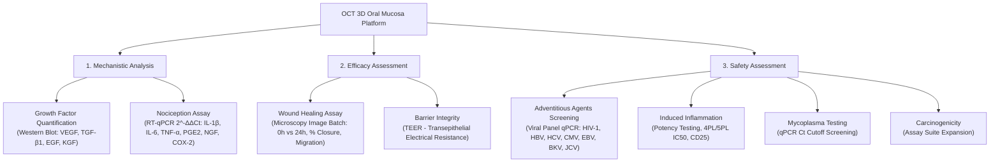
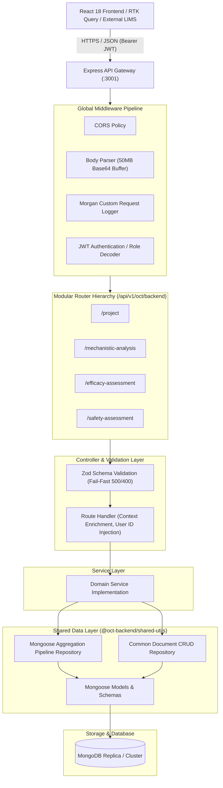
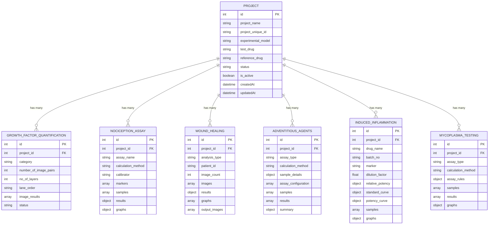
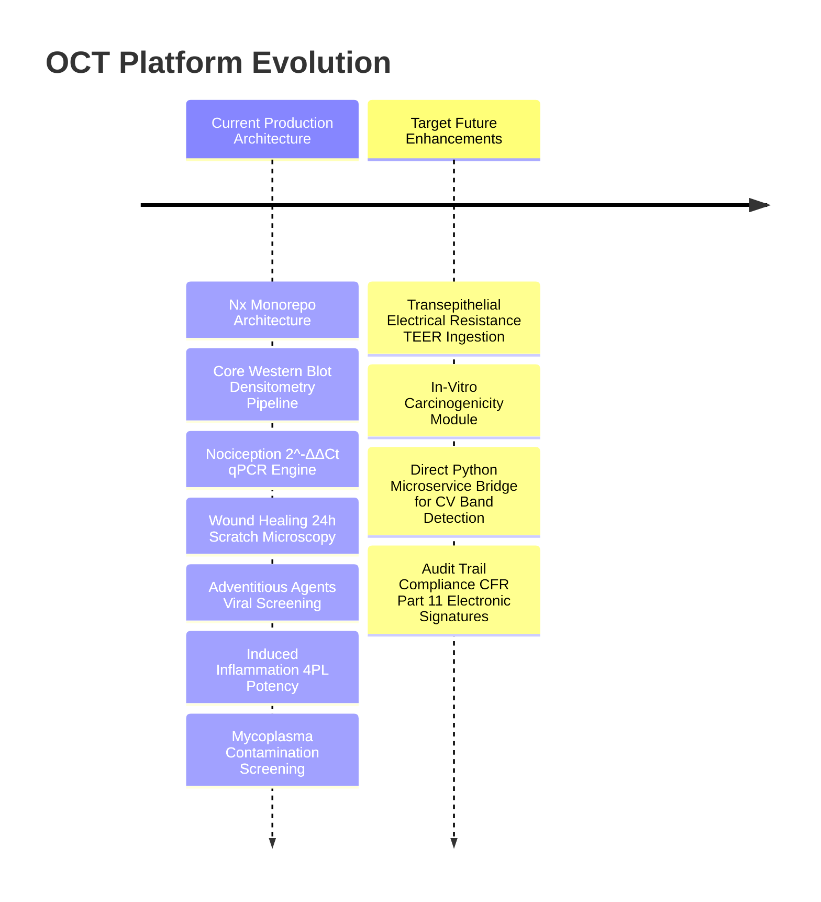

# OCT Backend - Technical Architecture Document
**Oral Cell Technology (OCT) 3D Oral Mucosa In-Vitro Assessment Platform**

---

## 1. Executive Summary & System Overview

The **OCT (3D Oral Mucosa Platform)** backend is a specialized clinical assay data management, automated densitometry, and bio-analytical calculation engine. Designed to support in-vitro preclinical and translational evaluation of therapeutic candidates, the platform benchmarks **Test Drugs (TD)** against **Reference Drugs (RD)** and vehicle **Controls** using human 3D tissue models (e.g., **OMM-hMPS** - Oral Mucosa Model - human Mucosal Phenotype System).

The backend system is architected as a high-throughput, modular TypeScript/Node.js service deployed inside an **Nx Monorepo**. It provides:
1. **Automated Densitometry & Band Quantification**: Processing dual-image Western blot payloads (target protein + $\beta$-actin loading control) to eliminate manual spreadsheet errors.
2. **Multi-Assay Bio-Analytical Processing**: Housing three primary assessment modules (**Mechanistic Analysis**, **Efficacy Assessment**, and **Safety Assessment**) covering 7 specialized assays.
3. **Structured Data Storage & Relational Linkage**: MongoDB-backed schema storage using auto-incrementing document identifiers, pagination, and relational projection against central Study Projects.
4. **Standardized REST API Envelope**: Type-safe validation using Zod and unified response envelopes for consumption by the React 18 / Redux Toolkit frontend.

---

## 2. Platform Scientific & Functional Domain

The platform models study runs (e.g., `OCT-001: Test Drug vs Reference Drug on OMM-hMPS tissue`) across three core scientific pillars:



### Module Breakdown
* **Mechanistic Analysis**:
  * *Growth Factor Quantification*: Automated lane detection (2–12 configurable lanes), background-subtracted band intensity, $\beta$-actin normalization, fold change vs. reference, ranking, and clinical KPIs (Mean TD, Mean RD, TD/RD ratio).
  * *Nociception Assay*: Real-time quantitative PCR pain pathway expression analysis calculating $\Delta C_t$, $\Delta\Delta C_t$, standard deviation, and relative fold gene expression.
* **Efficacy Assessment**:
  * *Wound Healing*: High-resolution microscopy batch image analysis measuring open wound area, closure percentage, and cell migration rates across 0-hour and 24-hour timepoints.
  * *Barrier Integrity*: Quantitative assessment of mucosal tightness via Transepithelial Electrical Resistance.
* **Safety Assessment**:
  * *Adventitious Agents Screening*: Multi-target viral screening across 7 critical viral agents with negative, positive, and internal extraction process controls.
  * *Induced Inflammation*: Standard curve and 4-parameter logistic (4PL) potency curve quantification, deriving $IC_{50}$, $\log(IC_{50})$, HillSlope, and Relative Potency percentage.
  * *Mycoplasma Testing*: Rapid qPCR cutoff screening ($C_t < 35.0$ detection threshold, borderline intervals, extraction blanks).

---

## 3. High-Level Technical Architecture

The backend follows a layered, decoupled service architecture within an Nx workspace.



---

## 4. Workspace & Repository Structure

The codebase is organized in an enterprise monorepo using **Nx 24**, **TypeScript 5/6**, and **Node.js (ESM)**:

```
oct_backend/
├── apps/
│   └── backend_service/            # Core Express HTTP Microservice
│       ├── src/
│       │   ├── config/             # Runtime environment configuration
│       │   │   └── env.ts
│       │   ├── controllers/        # Domain controllers & route groupings
│       │   │   ├── project/        # Central Study Projects CRUD
│       │   │   ├── mechanistic_analysis/
│       │   │   │   ├── growth_factor_quantification/
│       │   │   │   └── nociception_assay/
│       │   │   ├── efficacy_assessment/
│       │   │   │   └── wound_healing/
│       │   │   └── safety_assessment/
│       │   │       ├── adventitious_agents/
│       │   │       ├── induced_inflammation/
│       │   │       └── mycoplasma_testing/
│       │   ├── main.ts             # Application entrypoint & server bootstrap
│       │   └── router.ts           # Root route registry & URL prefix mapper
│       ├── tsconfig.app.json
│       └── package.json
├── libs/
│   └── shared-utils/               # Reusable internal package (@oct-backend/shared-utils)
│       ├── src/
│       │   ├── lib/
│       │   │   ├── database/mongo_db/
│       │   │   │   ├── models/     # Mongoose entity schemas & indexes
│       │   │   │   └── repository/ # Query builders, aggregations & pagination
│       │   │   ├── db_connectors/  # MongoDB auto-reconnect client
│       │   │   ├── helpers/        # CSV exporters, crypto utilities, emailer
│       │   │   └── middleware/     # JWT authentication, response envelopes
│       │   └── index.ts            # Public barrel exports
│       └── package.json
├── docs/                           # Domain specs, cURL docs & schema references
├── nx.json                         # Monorepo build targets & caching config
├── tsconfig.base.json              # Shared path mappings
└── package.json                    # Workspace dependencies & root scripts
```

---

## 5. Architectural Design Patterns & Principles

### 5.1. Separation of Concerns (Layered Architecture)
Every assessment endpoint follows a clean, 4-tier separation:
1. **Validation (`validation.ts`)**: Strict Zod type inference enforcing required fields and structural integrity. Uses `.passthrough()` to allow future bio-informatic metadata extensions without breaking contract compliance.
2. **Controller Handler (`handler.ts`)**: Extracts request parameters, handles token claims (`created_by_id`, `updated_by_id`), applies defaults (e.g., `is_active: true`, timestamps), and coordinates with services.
3. **Service Layer (`service.ts`)**: Encapsulates business logic, database transactions, and error propagation.
4. **Repository Layer (`repository/*.ts`)**: Houses database interactions, including specialized MongoDB `$lookup` aggregation pipelines that join project metadata and perform server-side pagination.

### 5.2. Auto-Incrementing Numeric Identity Pattern
While MongoDB natively generates 12-byte `_id` (`ObjectId`), all domain entities implement a pre-save hook that queries the latest document and assigns a human-readable, sequentially incremented integer `id` (e.g., `1, 2, 3...`). This enables clean URL parameters (`/:id/update`, `/:id`) and matches standard clinical Laboratory Information Management Systems (LIMS) conventions.

```typescript
schema.pre("save", async function () {
  if (this.isNew && this.id == null) {
    const latest = await (this.constructor as any).findOne({}, {}, { sort: { id: -1 } });
    this.id = latest ? latest.id + 1 : 1;
  }
});
```

### 5.3. Relational Project Projection via Aggregation Pipelines
Assays store a foreign reference `project_id: Number`. To avoid client-side waterfalls (N+1 queries), `Get` and `List` queries execute a native MongoDB aggregation pipeline:
* Normalizes incoming filter types (`id`, `project_id` to integer numbers).
* Performs `$lookup` against the `projects` collection matching `project_id` to `project.id`.
* Employs `$unwind` with `preserveNullAndEmptyArrays: true`.
* Projects clean clinical summary objects (`project_name`, `project_unique_id`, `experimental_model`, `test_drug`, `reference_drug`, `status`).

### 5.4. Universal Upsert Capability
All assay controllers implement an idempotent `upsert` mechanism:
* Matches by primary integer `id` if provided.
* Matches composite key `{ project_id, category }` if provided.
* Falls back to `{ category }` for global module definitions.

---

## 6. Data Modeling & Database Architecture

MongoDB serves as the persistence engine, utilizing Mongoose ODM and `mongoose-paginate-v2`.

### 6.1. Entity Relationship Overview



### 6.2. Indexing Strategy
Compound indexes are provisioned on every assay collection to guarantee sub-millisecond retrieval under large study catalogs:
* `id: 1` (Unique B-tree index)
* `createdAt: -1` (Descending sort optimization for chronological feeds)
* `project_id: 1` (Foreign key lookup acceleration)
* `category: 1` (Module partition filtering)

---

## 7. API Architecture & Routing Taxonomies

### 7.1. Base URL Routing Strategy
To support both product brand names and legacy clients, the router exposes dual versioned path prefixes:
* Primary Endpoint: `http://localhost:3001/api/v1/oct/backend`
* Alias Endpoint: `http://localhost:3001/api/v1/transcell/backend`

### 7.2. Canonical Module Routes

| Domain Pillar | Resource Route | Target Collection | Primary Capabilities |
|---|---|---|---|
| **Core** | `/project` | `projects` | Study metadata, protocol definitions, drug pairing |
| **Mechanistic** | `/growth-factor-quantification` | `growth_factor_quantifications` | Western blot dual-image upload, lane densitometry |
| **Mechanistic** | `/nociception-assay` | `nociception_assays` | RT-qPCR pain pathway $\Delta\Delta C_t$ quantification |
| **Efficacy** | `/wound-healing` | `wound_healings` | Microscopy batch processing (0h vs 24h scratch area) |
| **Safety** | `/adventitious-agents` | `adventitious_agents` | 7-target viral screening panel ($C_t$ cutoff) |
| **Safety** | `/induced-inflammation` | `induced_inflammations` | ELISA 4PL/5PL standard curve, $IC_{50}$, relative potency % |
| **Safety** | `/mycoplasma-testing` | `mycoplasma_testings` | Mycoplasma contamination qPCR screening |

*Note: All endpoints are also mounted via both kebab-case (e.g., `/wound-healing`) and snake_case (e.g., `/wound_healing`) aliases.*

### 7.3. Uniform CRUD Operation Contract

Every assay implements the identical, predictable REST contract:

```
POST   /:resource/create        -> Creates a new document
POST   /:resource/upsert        -> Idempotent upsert by id or project_id
POST   /:resource/:id/update    -> Partial/full update by numeric ID
DELETE /:resource/:id/delete    -> Hard delete by numeric ID
GET    /:resource/:id           -> Fetch single document with joined project metadata
GET    /:resource               -> Filtered list with pagination, counts, and sorting
```

### 7.4. Standardized Response Envelopes

#### Success Envelope (`SUCCESS_RESP`)
```json
{
  "meta": {
    "status": true,
    "message": "WoundHealing Created Successfully"
  },
  "data": { ... }
}
```

#### Paginated Success Envelope (`SUCCESS_RESP_WITH_PAGINATION`)
```json
{
  "meta": {
    "status": true,
    "message": "AdventitiousAgents retrieved Successfully"
  },
  "pagination": {
    "per_page": 10,
    "page_no": 1,
    "total_rows": 45,
    "total_pages": 5
  },
  "data": [ ... ]
}
```

#### Failure Envelope (`FAILURE_RESP`)
```json
{
  "meta": {
    "status": false,
    "message": "Validation Failed"
  },
  "error": {
    "name": "Validation Error",
    "message": [ ... ]
  }
}
```

---

## 8. Cross-Cutting Concerns & Security

### 8.1. Authentication & Identity Context
* **Stateless JWT Verification**: Requests pass through the `authentication` middleware verifying standard `Authorization: Bearer <TOKEN>`.
* **Auditing Context**: Upon verification, user ID claims (`decoded.ID`) are automatically stamped onto `created_by_id` or `updated_by_id`.
* **Graceful Test Fallback**: In integration test environments, unverified requests are safely caught without throwing unhandled exceptions.

### 8.2. High-Capacity Base64 Image Processing
Western blot densitometry and microscopy image batches require high-fidelity image buffers. Express limits are configured to **50MB**:
```typescript
app.use(express.json({ limit: "50mb" }));
app.use(express.urlencoded({ limit: "50mb", extended: true }));
```

### 8.3. Connection Fault Tolerance
Database connection incorporates a self-healing retry loop (`connectWithRetry`) preventing pod/container death during transient MongoDB restarts:
```typescript
export const connectWithRetry = async (uri: string) => {
  while (true) {
    try {
      await mongoose.connect(uri);
      break;
    } catch (err) {
      console.error('MongoDB connection failed. Retrying in 5 seconds...', err);
      await new Promise(res => setTimeout(res, 5000));
    }
  }
};
```

### 8.4. Observability & Logging
* Custom **Morgan** token formatter capturing ISO timestamp, HTTP verb, route path, HTTP version, and downstream status code.
* Fail-safe port collision monitoring intercepting `EADDRINUSE` with clear terminal guidance.

---

## 9. Build, Test & Deployment Lifecycle

### 9.1. Monorepo Build Orchestration
Nx manages computation caching and target dependencies:
* Shared libraries build first: `nx run @oct-backend/shared-utils:build`
* Application builds second: `nx run @org/backend_service:build` via `tsc --build tsconfig.app.json`

### 9.2. Runtime Commands
* **Development Server**: `npm run dev` (`nx serve @org/backend_service` with hot-reloading `tsx watch`)
* **Production Build**: `npm run build` (`nx build @org/backend_service` emitting compiled outputs to `dist/`)
* **Production Execution**: `node dist/apps/backend_service/src/main.js`

---

## 10. Architectural Assessment & Future Roadmap



1. **Computer Vision Microservice Integration**: Direct gRPC or internal message bus connection to dedicated Python CV microservices (OpenCV/PyTorch) for server-side band edge detection and automatic scratch migration masks.
2. **21 CFR Part 11 Compliance & Audit Trails**: Immutability logging and electronic signature verification across all assay result sign-offs.
3. **Automated Report Generation**: Integration of a PDF/Word generation pipeline directly converting stored chart base64 strings and quantification KPIs into regulatory submission dossier annexes.

